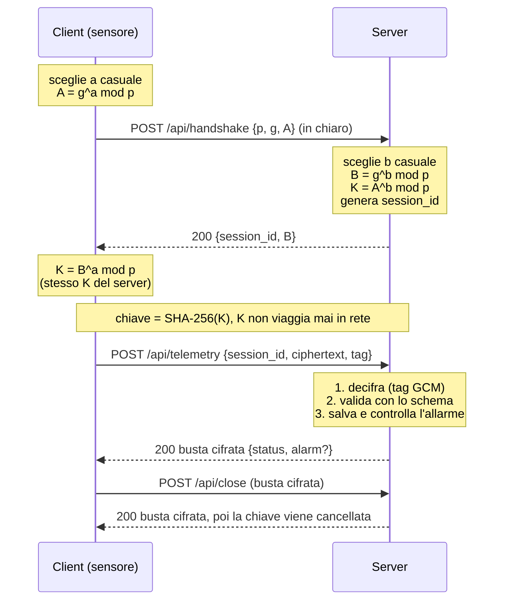

# Amadini_frigotrack
# Telemetria sicura per la catena del freddo

Prototipo di piattaforma per la raccolta di misure di temperatura da sensori di celle frigorifere e camion.

Il canale resta **HTTP** (niente HTTPS): la sicurezza è a carico dell'applicazione.

- La chiave di cifratura viene concordata con **Diffie-Hellman** e **non viaggia mai in rete**.
- I messaggi sono cifrati con **AES-256-GCM**, che garantisce anche l'integrità.
- Ogni messaggio è validato con **JSON Schema** (draft 2020-12).

**Autore:** [Leonardo Amadini] – classe 5IB

## Tecnologie

C# · .NET 8 · ASP.NET Core (minimal API) · JsonSchema.Net · xUnit

## Struttura del repository

| Cartella | Contenuto |
|---|---|
| `schemas/` | Un file JSON Schema per ogni tipo di messaggio |
| `FrigoTrack.Common` | Diffie-Hellman, AES-GCM, validazione degli schemi, client del protocollo |
| `FrigoTrack.Server` | Server HTTP su `http://localhost:5000` |
| `FrigoTrack.Client` | App console che simula 3 sensori |
| `FrigoTrack.Tests` | Test automatici xUnit |

## Avvio

Requisiti: Visual Studio 2022 con il carico di lavoro *ASP.NET e sviluppo Web* (oppure .NET 8 SDK).

### Da Visual Studio

1. Apri `FrigoTrack.sln` (i pacchetti NuGet si ripristinano da soli).
2. Tasto destro sulla soluzione → **Configura progetti di avvio…** → *Più progetti di avvio*.
3. Imposta `FrigoTrack.Server` e `FrigoTrack.Client` su **Avvia** (Server sopra il Client), gli altri su *Nessuno*.
4. Premi **F5**.

### Da terminale

```bash
# finestra 1
dotnet run --project FrigoTrack.Server

# finestra 2
dotnet run --project FrigoTrack.Client
dotnet run --project FrigoTrack.Client -- --invalid   # demo con una misura non valida

# test
dotnet test
```

Il client simula 3 sensori (`CELLA-BG-007` farmaci, `CAMION-MI-012` alimenti, `CELLA-BS-003` surgelati). Ognuno fa il proprio handshake, invia 6 misure a intervalli regolari, consulta le misure salvate e chiude la sessione.

Le misure vengono salvate dal server in `data/readings.json`, nella cartella di output del progetto Server (es. `FrigoTrack.Server/bin/Debug/net8.0/data/`).

## Protocollo

Il dialogo ha due fasi: prima l'**handshake**, che produce la chiave di sessione, poi lo **scambio di messaggi cifrati**.

### Handshake



- Gruppo: **RFC 3526, gruppo 14** (2048 bit), generatore `g = 2`. Il server accetta solo questo gruppo.
- Segreti `a` e `b`: 256 bit casuali. Il calcolo usa `BigInteger.ModPow`; lo scambio è implementato nel progetto, senza librerie che lo eseguano.
- Chiave AES-256 = SHA-256 del segreto condiviso K.

### Busta cifrata

Dopo l'handshake, ogni messaggio viaggia in questa forma (tutto in Base64, tranne `session_id`):

```json
{
  "session_id": "a3f9c2e1",
  "ciphertext": "mH3t...Base64...==",
  "tag": "8dK2...Base64...=="
}
```

- `ciphertext` contiene `nonce (12 byte) + dati cifrati`; il nonce è nuovo a ogni messaggio.
- `tag` è il tag di autenticazione GCM (16 byte).
- Il `session_id` è autenticato come dato associato: una busta non può essere spostata su un'altra sessione.

Regola di sicurezza del server: **prima decifra, poi valida**. Se la decifratura o il tag falliscono, risponde 400 senza elaborare nulla.

### Endpoint

| Endpoint | Metodo | Richiesta | Risposta |
|---|---|---|---|
| `/api/handshake` | POST | `p`, `g`, `A` (in chiaro) | `session_id`, `B` |
| `/api/telemetry` | POST | busta con la misura del sensore | busta con ack ed eventuale allarme |
| `/api/readings` | POST | busta con la richiesta (sensore, intervallo) | busta con l'elenco delle misure |
| `/api/close` | POST | busta | busta di conferma, poi la chiave viene cancellata |

### Messaggio applicativo (prima della cifratura)

```json
{
  "sensor_id": "CELLA-BG-007",
  "timestamp": "2026-11-02T08:15:30Z",
  "cargo_type": "pharma",
  "temperature_c": 4.6,
  "humidity": 55,
  "battery": 87
}
```

### Schemi JSON

| File in `schemas/` | Messaggio |
|---|---|
| `handshake-request.json` | richiesta di handshake |
| `handshake-response.json` | risposta di handshake |
| `envelope.json` | busta cifrata |
| `telemetry-request.json` | misura del sensore |
| `telemetry-response.json` | ack ed eventuale allarme |
| `readings-request.json` | richiesta di misure (sensore, intervallo `from`/`to`) |
| `readings-response.json` | elenco delle misure |
| `close-request.json` | richiesta di chiusura |
| `close-response.json` | conferma di chiusura |
| `error.json` | errore, con il campo sbagliato in `details` |

Gli schemi usano `type`, `required`, `enum`, `minimum`/`maximum`, `pattern`, `format` e `additionalProperties: false`. Il client valida il messaggio **prima di cifrarlo**; il server lo valida **dopo averlo decifrato**.

Esempio di errore (cifrato nella risposta):

```json
{
  "error": "bad_request",
  "message": "Messaggio non valido",
  "details": [
    { "field": "/temperature_c", "message": "Value is greater than or equal to 40" }
  ]
}
```

### Codici HTTP

| Codice | Quando |
|---|---|
| 200 | Richiesta elaborata |
| 400 | JSON o busta malformati, decifratura/tag falliti, messaggio non conforme allo schema |
| 401 | `session_id` inesistente o sessione chiusa |
| 404 | Endpoint inesistente, oppure sensore senza misure in `/api/readings` |

## Allarmi

Se la temperatura esce dall'intervallo di sicurezza del tipo di merce, la risposta contiene un campo `alarm`.

| `cargo_type` | Intervallo di sicurezza |
|---|---|
| `pharma` | 2 – 8 °C |
| `food` | 0 – 5 °C |
| `frozen` | −30 – −18 °C |

## Test

`dotnet test` esegue 6 test sul server in memoria:

1. handshake riuscito
2. misura valida (200 e ack cifrato)
3. misura non valida (400 e campo errato indicato)
4. busta manomessa (400)
5. sessione inesistente (401)
6. allarme per farmaci fuori intervallo

## Limiti noti

- **Nessuna protezione da replay**: una busta valida intercettata può essere rinviata.
- **Diffie-Hellman non autenticato**: un attaccante attivo (man-in-the-middle) potrebbe fare handshake con entrambe le parti.
- Gli errori 400/401 prodotti *prima* di avere la chiave sono in chiaro (ma generici).
- Sessioni e chiavi sono solo in memoria: si perdono al riavvio e non scadono da sole.
- Le misure sono salvate in un unico file JSON riscritto a ogni invio: adatto a un prototipo, non a migliaia di sensori.
- La chiave AES è `SHA-256(K)` senza HKDF; il `session_id` è di soli 32 bit.
